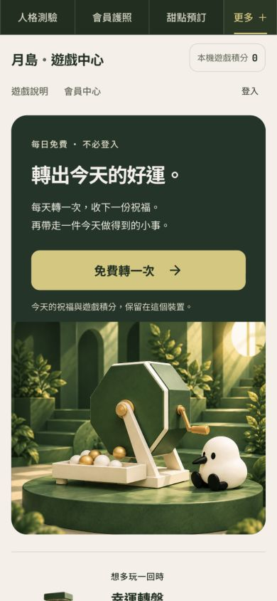
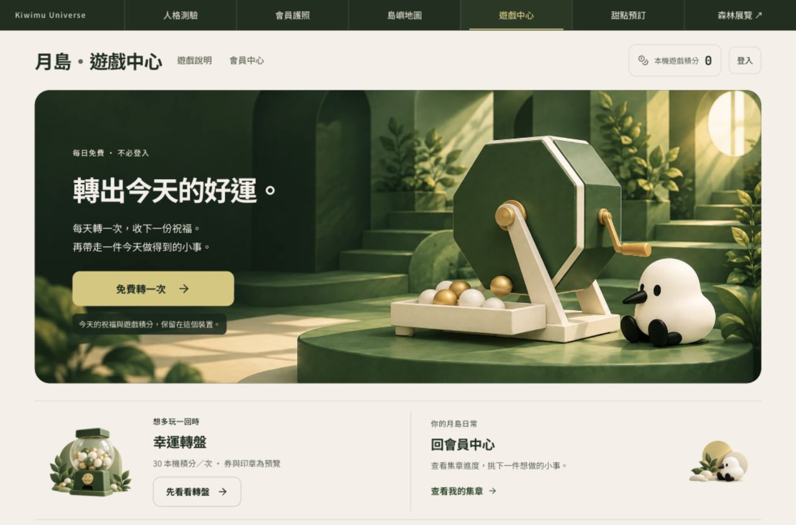
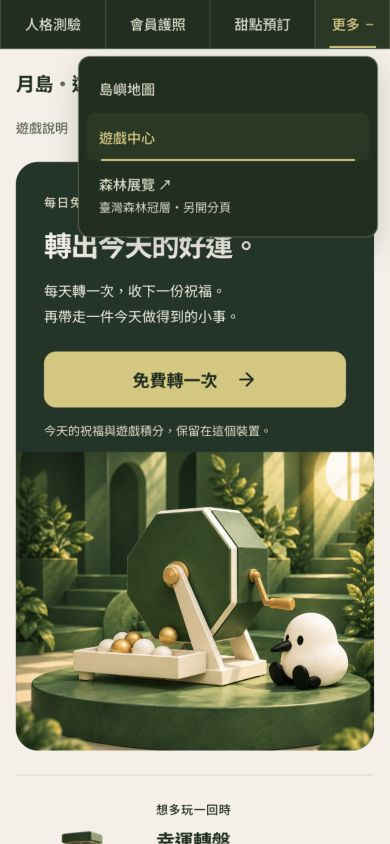

# Gacha 月島共同導覽候選｜2026-10-13

Penso 要求全部上方 bar 統一；以已上線的 Passport 深綠導覽為基準。

## 改動

深綠 `#1F2F1F`、奶油白 `#F5F0E8`、柔金 `#D7C678`。中文入口 14px、操作區 48px。桌機保留五站與森林展覽；手機顯示人格測驗／會員護照／甜點預訂，其餘放在「更多」。支援 Escape、點外部、離開焦點與切回桌機時收合。

保留 `gacha_universe_rail` 與既有 outbound tracking。遊戲成本、積分、機率與登入流程沒有改動。

## 驗證

`npx tsc --noEmit`、`npm run build`、`node scripts/check-entry-from.mjs`、`node scripts/test-pwa-consent.mjs`、`node scripts/test-saved-fortune.mjs` 全部通過。

作者內建瀏覽器 5 案：320／390／768／1280px 與本專案公開頁，水平溢出 0，導覽顏色、字級與 ≥44px 操作區通過；「更多」與 Escape 正常。

獨立程式覆核 APPROVE；runtime diff SHA256：`cdbd1d61b44808d0b826d67424cb94708fdc43426d86589d97422092e786cb8c`。作者瀏覽器 QA 不等於獨立視覺或真人簽收。

## 狀態與限制

候選尚未合併、未部署 production；須 Penso 批准。不是五站完整內容驗收；未真人 Safari／LINE／VoiceOver、登入、交易、抽獎、點數／核銷或通知送達驗收。QA 過程隔離 API 與分析。

本機：[候選預覽](http://127.0.0.1:5252/)

## 畫面

